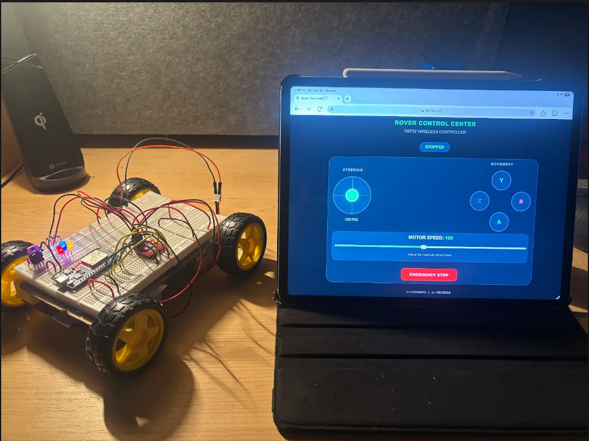
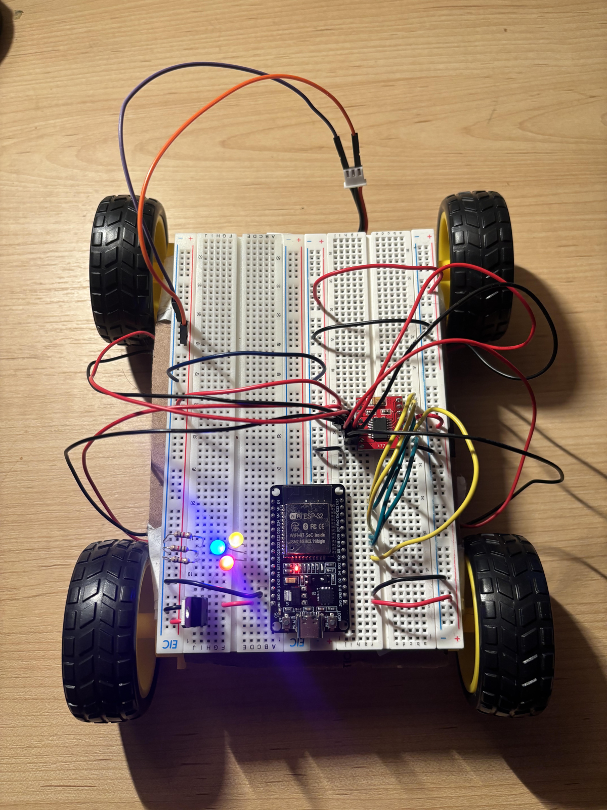
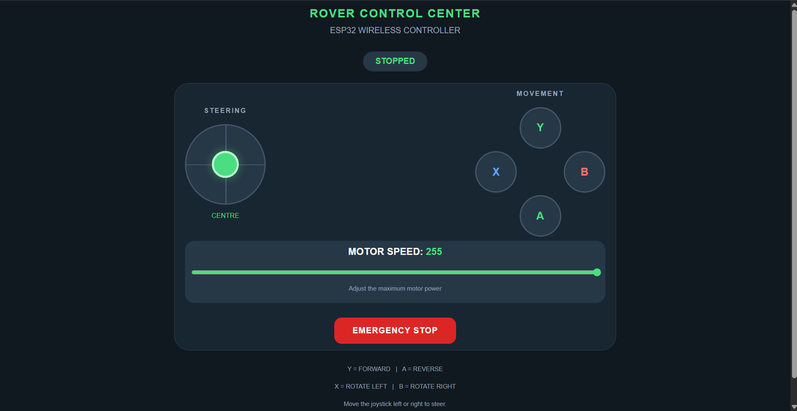

# ESP32 4WD Wi-Fi Controlled Robot 🚗

<p align="center">
  
</p>

<p align="center"><em>The finished robot beside the browser-based controller it hosts on its own Wi-Fi network.</em></p>

<table align="center">
  <tr>
    <td align="center" valign="middle" width="50%">
      
    </td>
    <td align="center" valign="middle" width="50%">
      
    </td>
  </tr>
  <tr>
    <td align="center"><em>Electronics and wiring</em></td>
    <td align="center"><em>Browser-based controller</em></td>
  </tr>
</table>

---
 
# 🎥 Project Demonstration

**Final Robot Demonstration**

<p align="center">
  <a href="https://github.com/user-attachments/assets/48b1dec5-cbc4-494a-885c-afe4893c26c6">
    
  </a>
</p>

<p align="center"><em>▶ Click the image to watch the full demonstration</em></p>

This project is an upgraded version of my original wireless RC car, redesigned around an ESP32 microcontroller and a four-wheel-drive drivetrain.
 
Instead of using a dedicated wireless transmitter and receiver, the robot hosts its own Wi-Fi network and embedded web server. This allows it to be controlled directly from a phone, tablet, or computer through a browser.
 
The final system combines:
 
- ESP32-based embedded control
- Four-wheel-drive propulsion
- TB6612FNG motor driver
- Four geared DC motors
- Wi-Fi communication through an ESP32 access point
- Custom HTML, CSS, and JavaScript controller
- Differential steering
- Independent forward and reverse control
- Adjustable PWM motor speed
- In-place pivot turning
- Emergency stop functionality
- Communication watchdog protection
---
 
# 📌 Project Overview
 
The goal of this project was to redesign and improve my original Arduino-based wireless RC car by developing a more integrated robotic control system.
 
The original project used two Arduino-based systems communicating through nRF24L01 wireless transceivers. Although this architecture successfully provided wireless vehicle control, I wanted to explore a different approach.
 
The new design uses an ESP32 as both the main microcontroller and wireless access point.
 
This eliminates the need for a separate transmitter and receiver. Instead, the ESP32 hosts a web application that acts as the robot's controller.
 
The project focuses on integrating several engineering disciplines:
 
- Embedded systems programming
- DC motor control
- H-bridge motor driver
- PWM speed regulation
- Wi-Fi communication
- HTTP-based command processing
- Differential-drive control
- Web development
- Electrical integration
- System-level troubleshooting
The objective wasn't simply to make four motors spin.
 
It was to develop a complete robotic vehicle where the mechanical drivetrain, electrical hardware, embedded software, and wireless interface operate together.
 
---
 
# 🔗 Project Evolution: Version 1 → Version 2
 
This project builds upon my previous RC car project:
 
[**Wireless Arduino RC Car – Version 1**](https://github.com/yashab248/WIRELESS_RC_CAR-Version-1-)
 
The original vehicle used an Arduino-based transmitter and receiver architecture, with an nRF24L01 wireless communication system, a single propulsion motor, servo-actuated steering, and Ackermann steering geometry.
 
For this version, I redesigned the vehicle around a four-wheel-drive configuration.
 
The main change was moving from a mechanically steered RC car to a differential-drive robotic platform.
 
| Feature                | Version 1                         | Version 2                      |
| ---------------------- | --------------------------------- | ------------------------------ |
| Main controller        | Arduino Uno                       | ESP32 DevKit V1                |
| Wireless communication | nRF24L01                          | Built-in Wi-Fi                 |
| Control interface      | Physical joystick                 | Browser-based controller       |
| Motor configuration    | Single propulsion motor           | Four DC motors                 |
| Motor drivers          | TB6612FNG                         | TB6612FNG                      |
| Steering               | Servo + Ackermann geometry        | Differential steering          |
| Turning                | Mechanical front-wheel steering   | Left/right motor speed control |
| Speed control          | PWM                               | Adjustable PWM                 |
| Wireless architecture  | Separate transmitter and receiver | ESP32-hosted web server        |
 
### Why Redesign the System?
 
I wanted to simplify the wireless architecture while introducing a more flexible method of controlling the vehicle.
 
The ESP32 provided several advantages:
 
1. Integrated Wi-Fi eliminated the need for a separate wireless transceiver.
2. An embedded web server allowed the controller to run directly on the robot.
3. A browser interface made the vehicle accessible from multiple devices.
4. Four-wheel drive provided propulsion through all four wheels.
5. Differential steering eliminated the need for a steering servo and mechanical steering linkage.
The redesign also introduced new software challenges involving HTTP communication, control-state processing, motor synchronization, and communication failsafes.
 
---
 
# 🎯 Project Objectives
 
The main objectives were:
 
1. Develop a four-wheel-drive robotic vehicle using four geared DC motors.
2. Use an ESP32 as the central embedded controller.
3. Establish a wireless connection without requiring a separate transmitter.
4. Host a browser-based control interface directly on the ESP32.
5. Implement differential steering using left and right motor groups.
6. Support forward, reverse, and in-place rotational movement.
7. Implement adjustable motor speed using PWM.
8. Develop a responsive controller suitable for both desktop and mobile devices.
9. Implement emergency stopping and communication timeout protection.
10. Document the electrical, mechanical, and software architecture of the complete system.
---
 
# ⚙️ Final System Architecture
 
The robot is divided into four main subsystems:
 
1. Wireless communication
2. User interface and command processing
3. Embedded motor-control system
4. Electrical drivetrain
## 1. System Block Diagram
 
 
 
*Add your system architecture diagram here.*
 
The overall system follows this sequence:
 
```text
         PHONE / TABLET / COMPUTER
                    |
                    |
             Web Browser
                    |
             HTML / CSS / JS
                    |
                    |
          ESP32 WI-FI ACCESS POINT
                    |
              HTTP REQUESTS
                    |
                    |
          EMBEDDED WEB SERVER
                    |
                    |
           COMMAND PROCESSING
                    |
                    |
          MOTOR CONTROL LOGIC
                    |
             GPIO + PWM
                    |
                    |
           TB6612FNG DRIVERS
                    |
             /             \
       LEFT MOTORS      RIGHT MOTORS
             \             /
                    |
              FOUR WHEELS
```
 
The ESP32 handles wireless communication, command interpretation, and motor control.
 
The browser handles user input and continuously sends the current controller state to the ESP32.
 
---
 
# 🔩 Hardware Components
 
The following components were used to construct the robot.
 
| Component                                  |    Quantity | Function                    |
| ------------------------------------------ | ----------: | --------------------------- |
| ESP32 DevKit V1                            |           1 | Main microcontroller        |
| TB6612FNG Motor Driver                     |           1 | Dual H-bridge motor control |
| TT Geared DC Motors (3–6 V, 200 RPM, 1:48) |           4 | Vehicle propulsion          |
| Robot chassis                              |           1 | Mechanical structure        |
| Wheels                                     |           4 | Ground contact and movement |
| Red LED                                    |           1 | Status indication           |
| Blue LED                                   |           1 | Status indication           |
| Yellow LED                                 |           1 | Status indication           |
| 7.4 LiPo Battery                           |           1 | Electrical power source     |
| Connecting wires                           | As required | Electrical connections      |
 
*The exact battery specifications and final power-distribution configuration should be documented alongside the wiring diagram.*
 
## 1. ESP32 DevKit V1
 
The ESP32 acts as the central controller for the entire robot.
 
Unlike the previous Arduino-based design, the ESP32 combines microcontroller functionality with built-in wireless networking.
 
Its responsibilities include:
 
- Creating a Wi-Fi access point.
- Hosting the embedded web server.
- Receiving HTTP control commands.
- Processing throttle and steering inputs.
- Calculating motor PWM values.
- Controlling motor direction.
- Monitoring communication timeouts.
- Activating the motor-stop failsafe.
## 2. TB6612FNG Motor Drivers
 
One TB6612FNG motor driver is used to control the four DC motors by connecting the motor's positive and negative terminals across two output pins.

Therefore, the left-side motors are connected to the output A on the motor driver, and vice versa for the right-side motors on output B.

By connecting them in parallel, you get a shared signal between the left and right motors, thus reducing the use for 2 motor drivers, and separate digital / analog signals to be sent.
 
The TB6612FNG is a dual H-bridge motor driver, meaning each driver provides two bidirectional motor-control channels.
 
An H-bridge allows the voltage polarity applied to a motor to be reversed, changing its direction of rotation.
 
The driver accepts:
 
- Direction-control inputs
- PWM speed-control inputs
- Standby control
The two motor drivers are integrated into the four-wheel drivetrain, with corresponding left and right motor groups receiving synchronized control signals.
 
This allows the robot to operate using two primary motor groups:
 
- Left-side propulsion
- Right-side propulsion
The front and rear motors on each side operate together.
 
**Why use the TB6612FNG?**
 
The TB6612FNG provides bidirectional motor control and PWM speed regulation in a compact motor-driver module.
 
It allows the ESP32 to control the motors without attempting to supply motor current directly through its GPIO pins.
 
## 3. Four Geared DC Motors
 
The robot uses four TT geared DC motors.
 
Each motor includes a gearbox that reduces the output speed while increasing the available output torque.
 
The approximate motor specifications are:
 
| Parameter     | Specification           |
| ------------- | ----------------------- |
| Motor type    | Brushed DC geared motor |
| Rated voltage | 3–6 V                   |
| Rated speed   | Approximately 200 RPM   |
| Gear ratio    | 1:48                    |
| Quantity      | 4                       |
 
Using four motors provides propulsion at all four wheels.
 
Rather than mechanically steering the front wheels, the robot changes direction by controlling the relative speeds and directions of the left and right motor groups.
 
## 4. Status LEDs
 
Three LEDs are connected to the ESP32:
 
- Red LED: GPIO 26
- Blue LED: GPIO 25
- Yellow LED: GPIO 33
These outputs provide visual indications of the robot's operating state.
 
The firmware uses different output combinations for stopped, driving, and pivot-turning conditions.

All lights flash on when the car enters the braking state.

Only the Yellow LED stays on when you are rotating on the spot.

Only the Blue LED stays on when you are moving forwards or backwards, regardless whether you are driving straight or swerving
 
---
 
# 🔌 Electrical Connections
 
## ESP32 GPIO Assignments
 
The following pin assignments are used in the current firmware.
 
| ESP32 GPIO | Signal     | Function              |
| ---------- | ---------- | --------------------- |
| GPIO 23    | PWMA       | Left motor group PWM  |
| GPIO 21    | AIN2       | Left motor direction  |
| GPIO 22    | AIN1       | Left motor direction  |
| GPIO 18    | BIN1       | Right motor direction |
| GPIO 17    | BIN2       | Right motor direction |
| GPIO 19    | PWMB       | Right motor group PWM |
| GPIO 26    | Red LED    | Status indication     |
| GPIO 25    | Blue LED   | Status indication     |
| GPIO 33    | Yellow LED | Status indication     |
 
 
### Standby Connection
 
The TB6612FNG standby input (STBY) is connected to 3.3 V to keep the drivers enabled during normal operation.
 
### Wiring Diagram
 
<p align="center">
  
</p>
<p align="center"><em>Top-down view of the prototype wiring: ESP32 DevKit, TB6612FNG driver, status LEDs with resistors, and power distribution on the breadboards.</em></p>
*A formal circuit schematic (`hardware/circuit-schematic.png`) can be added here alongside this photo.*
 
---
 
# 📡 Wi-Fi Communication Architecture
 
One of the most significant changes in this version was replacing the dedicated wireless transmitter with an ESP32-hosted Wi-Fi network.
 
## 1. Creating a Wi-Fi Access Point
 
The ESP32 operates as a Wi-Fi access point using the Arduino `WiFi.h` library.
 
The network is created using:
 
```cpp
const char* ssid = "ROVER_WIFI";
const char* password = "YOUR_WIFI_PASSWORD";
 
WiFi.softAP(ssid, password);
```
 
When powered on, the robot creates its own wireless network.
 
A phone, tablet, or computer can connect directly to this network without requiring an external router or internet connection.
 
The default ESP32 access point address is:
 
```text
192.168.4.1
```
 
## 2. Embedded Web Server
 
The robot uses the Arduino `WebServer.h` library to host a web server on port 80.
 
```cpp
WebServer server(80);
```
 
The server provides two main routes:
 
| Route    | Purpose                         |
| -------- | ------------------------------- |
| `/`      | Serves the controller webpage   |
| `/drive` | Receives motor-control commands |
 
The root route sends the HTML webpage stored in the ESP32's program memory.
 
```cpp
server.on("/", HTTP_GET, []() {
    server.send(200, "text/html", webpage);
});
```
 
The drive route processes incoming controller information:
 
```cpp
server.on("/drive", HTTP_GET, handleCommand);
```
 
This allows the browser to communicate directly with the embedded motor-control system.
 
## 3. HTTP Command Structure
 
The browser sends the following parameters:
 
| Parameter  | Range       | Meaning                     |
| ---------- | ----------- | --------------------------- |
| `throttle` | -1 to 1     | Reverse, stop, or forward   |
| `steer`    | -100 to 100 | Steering input              |
| `pivot`    | -1 to 1     | Rotate left, none, or right |
| `speed`    | 60 to 255   | Maximum motor PWM           |
 
An example command looks like:
 
```text
/drive?throttle=1&steer=25&pivot=0&speed=150
```
 
This represents:
 
- Forward movement
- Right steering input
- No pivot rotation
- Motor speed setting of 150
The ESP32 receives these values and updates the internal control variables.
 
```cpp
throttle = constrain(server.arg("throttle").toInt(), -1, 1);
 
steering = constrain(server.arg("steer").toInt(), -100, 100);
 
pivot = constrain(server.arg("pivot").toInt(), -1, 1);
 
motorSpeed = constrain(server.arg("speed").toInt(), MIN_SPEED, MAX_SPEED);
```
 
The `constrain()` function prevents incoming values from exceeding the permitted control ranges.
 
---
 
# 🎮 Browser-Based Control Interface
 
Instead of developing a separate mobile application, I created a custom controller using HTML, CSS, and JavaScript.
 
The webpage is embedded directly into the ESP32 firmware and served whenever a user visits the robot's IP address.
 
## Controller Features
 
<p align="center">
  
</p>
<p align="center"><em>The Rover Control Center served by the ESP32 at <code>192.168.4.1</code>.</em></p>
The controller includes:
 
### 1. Analog Steering Joystick
 
The left side of the controller contains a virtual analog joystick.
 
The joystick measures horizontal pointer displacement and converts it into a steering value between -100 and +100.
 
```javascript
steering = Math.round((x / maxTravel) * 100);
```
 
The joystick also includes a deadzone to prevent small unintended movements.
 
```javascript
if (Math.abs(steering) < 8) {
    steering = 0;
    x = 0;
}
```
 
This ensures that small deviations around the center position do not cause unnecessary steering corrections.
 
### 2. Direction Buttons
 
The right side contains four directional buttons.
 
| Button | Function    |
| ------ | ----------- |
| Y      | Forward     |
| A      | Reverse     |
| X      | Pivot left  |
| B      | Pivot right |
 
The buttons use pointer events rather than relying exclusively on mouse clicks.
 
This allows the same controller to work with:
 
- Desktop mouse input
- Touchscreen input
- Mobile browsers
- Tablet browsers
The controller tracks whether each button is currently pressed or released.
 
When a button is released, its corresponding control state is reset.
 
### 3. Adjustable Speed Slider
 
The speed slider allows the user to adjust the maximum motor PWM value.
 
```html
<input
    type="range"
    id="speed"
    min="60"
    max="255"
    value="150"
>
```
 
The value is transmitted to the ESP32 as part of every drive command.
 
This allows the robot's movement to be adjusted without modifying the firmware.
 
### 4. Emergency Stop
 
The emergency stop button immediately clears the browser's movement inputs and sends a stop command.
 
The controller also updates its internal state to prevent previously held controls from continuing to request movement.
 
### 5. Mobile Optimization
 
The interface includes responsive CSS styling for different screen sizes.
 
Additional functionality includes:
 
- Landscape phone layout
- Touch-friendly buttons
- Pointer capture
- Disabled text selection
- Disabled long-press context menus
- Automatic control release when the page loses focus
These changes make the controller considerably more practical on a phone or tablet.
 
---
 
# 🧠 Motor Control Algorithms
 
The motor-control system is based on differential steering.
 
Rather than using a servo to mechanically change the direction of the wheels, the robot changes direction by varying the relative speeds of its left and right motor groups.
 
This is the central movement algorithm of the vehicle.
 
## 1. Differential Steering
 
Differential steering works by controlling the relative velocities of the left and right sides of a vehicle.
 
When both sides rotate at approximately the same speed, the robot moves in a straight line.
 
When one side rotates faster than the other, the robot follows a curved path.
 
For example:
 
| Left Motors    | Right Motors   | Result           |
| -------------- | -------------- | ---------------- |
| Forward        | Forward        | Straight forward |
| Slower forward | Faster forward | Turn left        |
| Faster forward | Slower forward | Turn right       |
| Reverse        | Reverse        | Straight reverse |
| Reverse        | Forward        | Pivot left       |
| Forward        | Reverse        | Pivot right      |
 
The algorithm takes two main inputs:
 
- `motorSpeed`: requested maximum motor PWM
- `steeringValue`: requested steering position
The steering input ranges from -100 to +100.
 
A negative steering value represents a left turn, while a positive value represents a right turn.
 
### Step 1: Calculate Steering Factors
 
The algorithm calculates a multiplier for each motor group:
 
[
L_f=100+s
]
 
[
R_f=100-s
]
 
Where:
 
- (L_f) = left motor factor
- (R_f) = right motor factor
- (s) = steering input
For straight-line movement:
 
[
s=0
]
 
Therefore:
 
[
L_f=100
]
 
[
R_f=100
]
 
Both motor groups receive equal PWM values.
 
### Step 2: Normalize the Motor Outputs
 
The steering factors must be normalized to ensure that neither motor group exceeds the requested maximum speed.
 
The maximum steering factor is:
 
[
F\_{\max}=\max(L_f,R_f)
]
 
The motor PWM values are then calculated using:
 
[
PWM_L=\frac{vL_f}{F\_{\max}}
]
 
[
PWM_R=\frac{vR_f}{F\_{\max}}
]
 
Where (v) represents the requested motor speed.
 
This preserves the relative steering ratio while keeping the larger motor output within the requested speed setting.
 
### Step 3: Apply Minimum PWM
 
DC motors may not reliably begin rotating at very low PWM values.
 
To account for this, the firmware defines:
 
```cpp
const int MIN_SPEED = 60;
const int MAX_SPEED = 255;
```
 
After normalization, both motor outputs are constrained to a minimum PWM value of 60.
 
```cpp
leftPWM = max(leftPWM, MIN_SPEED);
rightPWM = max(rightPWM, MIN_SPEED);
```
 
This helps prevent one side from receiving insufficient power during a steering maneuver.
 
The minimum PWM is a motor-driving threshold, not a calibrated physical speed.
 
### Step 4: Apply Direction
 
The calculated PWM values are passed to the left and right motor-control functions.
 
```cpp
setLeftMotor(direction * leftPWM);
 
setRightMotor(direction * rightPWM);
```
 
The direction variable determines whether the robot moves forward or backward.
 
The motor-control functions handle direction through the H-bridge inputs and speed through PWM.
 
## 2. Reverse Steering Correction
 
When reversing, the relationship between steering input and the resulting vehicle direction must be adjusted.
 
The firmware handles this by inverting the steering input when the throttle direction is negative.
 
```cpp
if (direction == -1) {
    adjustedSteering = -adjustedSteering;
}
```
 
This ensures that the steering response remains consistent with the intended vehicle behavior while reversing.
 
## 3. Pivot Turning
 
The robot can rotate approximately in place by driving the left and right motor groups in opposite directions.
 
This is another advantage of differential steering.
 
### Pivot Left
 
- Left motor group rotates backward.
- Right motor group rotates forward.
```cpp
void rotateLeft() {
    setLeftMotor(-motorSpeed);
    setRightMotor(motorSpeed);
}
```
 
### Pivot Right
 
- Left motor group rotates forward.
- Right motor group rotates backward.
```cpp
void rotateRight() {
    setLeftMotor(motorSpeed);
    setRightMotor(-motorSpeed);
}
```
 
Because the two sides produce opposing rotational forces, the vehicle rotates around its approximate centre rather than following a conventional turning radius.
 
This is particularly useful for maneuvering in confined spaces.
 
## 4. Motor Direction Control
 
The `setLeftMotor()` and `setRightMotor()` functions convert signed speed commands into H-bridge direction signals and PWM outputs.
 
The input speed is constrained between -255 and +255.
 
The sign determines the direction:
 
- Positive: forward
- Negative: reverse
- Zero: motor outputs disabled
For the left motor group:
 
```cpp
if (speed > 0) {
    digitalWrite(AIN1, LOW);
    digitalWrite(AIN2, HIGH);
}
else if (speed < 0) {
    digitalWrite(AIN1, HIGH);
    digitalWrite(AIN2, LOW);
}
else {
    digitalWrite(AIN1, LOW);
    digitalWrite(AIN2, LOW);
}
 
analogWrite(PWMA, abs(speed));
```
 
The right motor group uses the same principle through `BIN1`, `BIN2`, and `PWMB`.
 
This separates the direction-control logic from the higher-level steering algorithm.
 
---
 
# 🔄 Control-State Management
 
The firmware uses three main control variables:
 
```cpp
int throttle = 0;
int steering = 0;
int pivot = 0;
```
 
These variables represent the current requested movement state.
 
| Variable   | Meaning                      |
| ---------- | ---------------------------- |
| `throttle` | Forward, reverse, or stopped |
| `steering` | Left or right steering input |
| `pivot`    | Pivot left, right, or none   |
 
The `applyControls()` function determines which movement operation should be executed.
 
## Movement Priority
 
The control system follows a priority structure:
 
1. Forward or reverse movement takes priority.
2. Pivot turning is allowed only when the joystick is approximately centred.
3. If no valid movement command is present, the motors stop.
The control logic is:
 
```cpp
if (throttle != 0) {
    drive(throttle, steering);
}
else if (abs(steering) <= STEERING_DEADZONE) {
 
    if (pivot == -1) {
        rotateLeft();
    }
    else if (pivot == 1) {
        rotateRight();
    }
    else {
        stopMotors();
    }
 
}
else {
    stopMotors();
}
```
 
This prevents conflicting movement commands from being applied simultaneously.
 
### Why Use a Steering Deadzone?
 
The joystick is not guaranteed to return to exactly zero every time.
 
Even a small displacement could otherwise produce an unintended steering command.
 
The firmware defines:
 
```cpp
const int STEERING_DEADZONE = 8;
```
 
Steering values within ±8 are treated as centred for the embedded pivot-control decision.
 
This also determines when the pivot buttons are allowed to operate.
 
---
 
# 🛑 Safety Systems and Failsafes
 
Wireless control introduces an important engineering consideration:
 
**What happens if the ESP32 stops receiving commands while the robot is moving?**
 
A robot should not continue driving indefinitely because its controller disconnects or its browser stops sending updates.
 
To address this, the firmware implements multiple stopping mechanisms.
 
## 1. Communication Watchdog
 
The browser sends controller data every 100 milliseconds.
 
```javascript
setInterval(sendCommand, 100);
```
 
Each valid command updates the ESP32's last-command timestamp:
 
```cpp
lastCommandTime = millis();
```
 
The firmware defines:
 
```cpp
const unsigned long WATCHDOG_TIMEOUT = 450;
```
 
The main loop continuously checks the elapsed time since the last command.
 
```cpp
if (motorsActive &&
    millis() - lastCommandTime > WATCHDOG_TIMEOUT) {
 
    stopMotors();
 
    Serial.println("WATCHDOG: MOTORS STOPPED!");
}
```
 
If the robot is moving and no valid command arrives for more than 450 milliseconds, the motor outputs are stopped.
 
This protects against situations such as:
 
- Browser disconnection
- Wi-Fi communication interruption
- Controller webpage failure
- Unexpected interruption of command transmission
The watchdog uses `millis()` rather than a blocking delay, allowing the ESP32 to continue servicing its web server.
 
## 2. Emergency Stop
 
The emergency stop is implemented on both the browser and embedded sides.
 
When activated, the browser:
 
1. Sets the emergency-stop state.
2. Clears all movement button states.
3. Resets the joystick.
4. Sends a zero-movement command.
The ESP32 then processes the command and stops the motors.
 
The emergency stop can be released by pressing a movement button again.
 
## 3. Browser Focus Failsafe
 
The browser also monitors whether the controller webpage remains active.
 
If the browser loses focus:
 
```javascript
window.addEventListener("blur", releaseAllControls);
```
 
If the webpage becomes hidden:
 
```javascript
document.addEventListener("visibilitychange", () => {
    if (document.hidden) {
        releaseAllControls();
    }
});
```
 
The controller clears its movement inputs and requests a stop.
 
This helps prevent the robot from continuing to receive movement commands when the user switches applications or leaves the controller webpage.
 
**Safety note:** These mechanisms are software-level safeguards, not a substitute for a physical power disconnect. The emergency stop also depends on the controller connection being available to deliver its command; the watchdog provides a separate timeout-based safeguard.
 
---
 
# 💡 LED Status Indication
 
The firmware controls three LEDs to indicate different motor states.
 
The current implementation uses the following output combinations:
 
| Operating state | Red LED | Blue LED | Yellow LED |
| --------------- | ------- | -------- | ---------- |
| Stopped         | HIGH    | HIGH     | HIGH       |
| Driving         | LOW     | HIGH     | LOW        |
| Pivot turning   | LOW     | LOW      | HIGH       |
 
The LEDs are controlled through GPIO 26, GPIO 25, and GPIO 33 respectively.
 
The HIGH/LOW combinations reflect the current firmware. Their physical illuminated states depend on the LED wiring and polarity.
 
---
 
# 💻 Software Architecture
 
The firmware combines several different technologies:
 
| Technology         | Purpose                                  |
| ------------------ | ---------------------------------------- |
| Arduino C++        | Embedded programming                     |
| ESP32 Arduino Core | Microcontroller functionality            |
| `WiFi.h`           | Wi-Fi access point                       |
| `WebServer.h`      | Embedded HTTP server                     |
| HTML               | Controller structure                     |
| CSS                | Controller styling and responsive layout |
| JavaScript         | User input and HTTP communication        |
 
The software can be divided into three major layers.
 
## Layer 1: User Interface
 
The browser handles:
 
- Joystick input
- Direction buttons
- Speed slider
- Emergency stop
- Controller status display
- Touch and pointer events
## Layer 2: Communication
 
The ESP32 handles:
 
- Wi-Fi access point creation
- HTTP request reception
- Request validation
- Command parsing
- Watchdog timestamp updates
## Layer 3: Embedded Motor Control
 
The embedded firmware handles:
 
- Movement prioritization
- Differential steering
- PWM calculations
- Direction control
- Pivot turning
- Motor stopping
- Watchdog protection
This separation makes it easier to understand how user input ultimately becomes physical motor movement.
 
---
 
# 🧪 Testing and Troubleshooting
 
Developing the robot involved more than simply assembling the hardware and uploading the firmware.
 
The system required testing at multiple levels to ensure that the electrical, mechanical, and software components worked together.
 
The following areas were particularly important.
 
## 1. Motor Direction Testing
 
Each motor group needed to be tested to confirm that the electrical polarity matched the intended direction of travel.
 
Because the motors are mounted in different orientations, their physical wiring polarity must be considered.
 
The final configuration was tested to ensure that:
 
- Both left motors move in the same intended direction.
- Both right motors move in the same intended direction.
- Forward commands move the robot forward.
- Reverse commands move the robot backward.
- Opposing motor commands produce rotational movement.
## 2. Differential Steering Testing
 
The steering algorithm was tested at different steering inputs.
 
The objective was to verify that:
 
- A zero steering input produces straight movement.
- Positive steering inputs produce right turns.
- Negative steering inputs produce left turns.
- Steering response remains consistent in reverse.
- Motor PWM values remain within their permitted range.
## 3. Motor Speed Testing
 
The speed slider was tested across its operating range.
 
The firmware allows a PWM setting between 60 and 255.
 
Testing was important because the four motors do not necessarily have identical mechanical characteristics.
 
Differences in motor performance can affect how straight the vehicle travels and how smoothly it turns.
 
## 4. Pivot Turning
 
The pivot-turning functionality was tested independently from normal driving.
 
Both directions were checked to ensure that the left and right motor groups received opposite direction commands.
 
## 5. Wireless Communication
 
The browser-based controller was tested using mobile devices and desktop browsers.
 
Particular attention was given to:
 
- Button press and release detection
- Touchscreen responsiveness
- Joystick movement
- Browser focus changes
- HTTP command transmission
- Wi-Fi connectivity
## 6. Watchdog Testing
 
The watchdog was designed to stop the motors when controller updates stop arriving.
 
The timeout mechanism is an important part of the overall system because wireless communication cannot be assumed to remain available indefinitely.
 
---
 
# 📊 Final Robot Capabilities
 
The completed firmware supports the following movement modes:
 
| Capability             | Implementation                |
| ---------------------- | ----------------------------- |
| Forward movement       | Both motor groups forward     |
| Reverse movement       | Both motor groups backward    |
| Left steering          | Differential PWM adjustment   |
| Right steering         | Differential PWM adjustment   |
| Reverse steering       | Inverted steering calculation |
| Pivot left             | Left backward, right forward  |
| Pivot right            | Left forward, right backward  |
| Adjustable speed       | Browser-based PWM slider      |
| Emergency stop         | Browser and embedded control  |
| Communication failsafe | 450 ms watchdog               |
| Wireless operation     | ESP32 Wi-Fi access point      |
| Remote interface       | Browser-based controller      |
 
---
 
# 🏗️ Engineering Development Process
 
One of the most valuable parts of this project was the development process itself.
 
The robot was built by taking an existing RC car design and changing its underlying architecture.
 
Rather than treating the project as a single assembly task, I approached it as a system integration problem.
 
The development process involved:
 
```text
       INITIAL RC CAR DESIGN
                 |
                 v
       IDENTIFY LIMITATIONS
                 |
                 v
        REDESIGN THE DRIVETRAIN
                 |
                 v
        INTEGRATE ESP32 CONTROL
                 |
                 v
       IMPLEMENT WI-FI CONTROL
                 |
                 v
       DEVELOP MOTOR ALGORITHMS
                 |
                 v
        TEST INDIVIDUAL SYSTEMS
                 |
                 v
       INTEGRATE COMPLETE ROBOT
                 |
                 v
         TEST AND REFINEMENT
```
 
Each subsystem had to work independently before being integrated into the complete vehicle.
 
This included testing the motor drivers, confirming motor directions, establishing the Wi-Fi connection, developing the browser controller, and implementing the movement algorithms.
 
The project demonstrated the importance of understanding how individual hardware and software decisions affect the behaviour of an entire electromechanical system.
 
---
 
# 🧠 What I Learned
 
This project provided practical experience with several areas of electrical and computer engineering.
 
### Embedded Systems
 
- Programming the ESP32 using Arduino C++.
- Configuring GPIO outputs.
- Generating PWM signals.
- Managing embedded web servers.
- Implementing state-based control.
- Handling asynchronous user inputs.
### Electrical Engineering
 
- Working with DC motors.
- Using H-bridge motor drivers.
- Understanding motor direction control.
- Integrating multiple motor drivers.
- Managing electrical connections and power distribution.
- Troubleshooting motor behaviour.
### Software and Algorithms
 
- Developing differential steering algorithms.
- Normalizing motor speed commands.
- Implementing steering deadzones.
- Managing competing control inputs.
- Developing communication watchdogs.
- Implementing emergency-stop logic.
### Wireless Communication
 
- Configuring an ESP32 access point.
- Hosting an embedded web server.
- Processing HTTP requests.
- Communicating between a browser and a microcontroller.
- Handling communication interruptions.
### System Integration
 
- Integrating mechanical, electrical, and software systems.
- Testing individual subsystems.
- Identifying hardware and software limitations.
- Debugging unexpected system behaviour.
- Improving the overall control experience.
---
 
# 📁 Repository Structure
 
The repository is organized to separate firmware, hardware documentation, engineering explanations, and project media.
 
```text
ESP32-4WD-WIFI-ROBOT/
│
├── README.md
│
├── firmware/
│   └── ESP32_4WD_Robot/
│       └── ESP32_4WD_Robot.ino
│
├── hardware/
│   ├── bill-of-materials.md
│   ├── pin-connections.md
│   ├── wiring-diagram.png
│   └── circuit-schematic.png
│
├── docs/
│   ├── system-architecture.md
│   ├── motor-control-algorithm.md
│   ├── wifi-communication.md
│   ├── safety-and-failsafe.md
│   └── design-evolution.md
│
├── media/
│   ├── photos/
│   │   ├── robot-with-controller.png
│   │   └── electronics-top-view.png
│   ├── videos/
│   ├── diagrams/
│   └── controller-screenshots/
│       └── controller-interface.png
│
└── LICENSE
```
 
---
 
# 🚀 Getting Started
 
The following instructions explain how to set up and operate the robot.
 
## 1. Hardware Requirements
 
Before uploading the firmware, assemble the robot using:
 
- ESP32 DevKit V1
- Two TB6612FNG motor drivers
- Four geared DC motors
- Robot chassis and wheels
- Battery and appropriate power connections
- Status LEDs
- Connecting wires
Verify the wiring against the electrical diagram before applying power.
 
## 2. Software Requirements
 
Install:
 
- [Arduino IDE](https://www.arduino.cc/en/software)
- [ESP32 Arduino Core](https://docs.espressif.com/projects/arduino-esp32/en/latest/installing.html)
The firmware uses the following libraries:
 
```cpp
#include <WiFi.h>
#include <WebServer.h>
```
 
These libraries are included with the ESP32 Arduino Core.
 
## 3. Uploading the Firmware
 
1. Open the Arduino IDE.
2. Open `ESP32_4WD_Robot.ino`.
3. Select the appropriate ESP32 development board.
4. Select the correct serial port.
5. Configure the Wi-Fi credentials.
6. Upload the firmware.
## 4. Connecting to the Robot
 
After uploading:
 
1. Power on the robot.
2. Open the Serial Monitor at 115200 baud.
3. Look for the Wi-Fi startup message.
4. Connect your phone, tablet, or computer to the robot's Wi-Fi network.
5. Open a browser.
6. Navigate to:
```text
http://192.168.4.1
```
 
The robot's control interface should appear.
 
## 5. Operating the Robot
 
| Input          | Action           |
| -------------- | ---------------- |
| Y              | Move forward     |
| A              | Move backward    |
| X              | Pivot left       |
| B              | Pivot right      |
| Joystick left  | Steer left       |
| Joystick right | Steer right      |
| Speed slider   | Adjust motor PWM |
| Emergency Stop | Stop the robot   |
 
Release the movement controls to stop requesting movement.
 
---
 
# 📸 Project Gallery
 
## Final Robot
 
<p align="center">
  
</p>
<p align="center"><em>The assembled robot with the tablet controller connected to its Wi-Fi network.</em></p>
## Electronics and Wiring
 
<p align="center">
  
</p>
<p align="center"><em>Top-down view of the ESP32, TB6612FNG driver, status LEDs, and wiring.</em></p>
## Controller Interface
 
<p align="center">
  
</p>
<p align="center"><em>Full-screen view of the browser-based controller.</em></p>
## Engineering Diagrams
 
*Diagrams will be added here.*
 
---
 
# 🔮 Future Improvements
 
Although the current robot provides wireless four-wheel-drive control, there are several areas where the platform could be improved.
 
Potential improvements include:
 
- Closed-loop motor speed control using wheel encoders.
- More precise speed matching between individual motors.
- Improved acceleration and deceleration profiles.
- Better handling of motor speed differences.
- More advanced drivetrain control.
- Improved communication reliability.
- Additional robot telemetry and diagnostics.
- Battery voltage monitoring.
- More detailed controller feedback.
These are potential future developments rather than features implemented in the current firmware.
 
---
 
# 🏁 Final Result
 
What started as an Arduino-based wireless RC car evolved into a four-wheel-drive robotic platform controlled entirely through an ESP32-hosted web interface.
 
The final system integrates:
 
- Four-wheel-drive propulsion
- Dual H-bridge motor control
- Differential steering
- PWM speed regulation
- Embedded Wi-Fi communication
- Browser-based control
- Safety and watchdog mechanisms
The most important part of this project was understanding how to redesign an existing system rather than simply adding more components to it.
 
Moving to an ESP32 changed the way the vehicle communicated, processed commands, and controlled its drivetrain.
 
It also introduced new opportunities to combine embedded programming with web development and real-time hardware interaction.
 
The project reinforced an important engineering principle:
 
**A successful electromechanical system requires more than individual components working correctly. It requires every subsystem to work together reliably.**
 
### Build → Integrate → Test → Diagnose → Improve
 
That was the engineering process behind the ESP32 4WD Wi-Fi Controlled Robot.
 
---
 
# 👨‍💻 Author
 
**Yash Kulkarni**
 
Computer Engineering Student | University of British Columbia
 
GitHub: [@yashab248](https://github.com/yashab248)
 
---
 
# 📜 License
 
This project is licensed under the MIT License. See the `LICENSE` file for details.
 
---
 
*This project was independently designed, assembled, programmed, and tested as a personal robotics and embedded systems project.*
 
